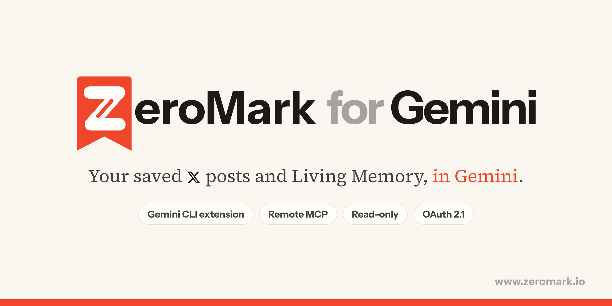

<div align="center">



# ZeroMark for Gemini CLI

**Your taste in X, in Gemini: what you kept, what you let go, what you concluded.**

[](https://github.com/asheus/zeromark-gemini-extension/actions/workflows/validate.yml)
[](#install)
[](https://modelcontextprotocol.io)
[](#privacy-and-security)
[](LICENSE)

[Website](https://www.zeromark.io) · [Connector guide](https://www.zeromark.io/docs/connector) · [Privacy](https://www.zeromark.io/privacy) · [Report a bug](https://github.com/asheus/zeromark-gemini-extension/issues/new/choose)

</div>

---

**Other connectors give your AI what you saved. ZeroMark gives it what you decided.**

[ZeroMark](https://www.zeromark.io) reads every post you bookmarked on X, and you clear the pile one decision at a time: Done or Let go. What you keep becomes your **Living Memory**, notes in your own words that change as you do. A pile of 3,000 bookmarks only says what you hoped to read; your decisions say what you actually think. That is your taste in X, and that is what your assistant reads here, read-only: it never decides for you.

This extension connects [Gemini CLI](https://github.com/google-gemini/gemini-cli) to ZeroMark's hosted MCP server, `https://www.zeromark.io/api/mcp`, and adds a `GEMINI.md` context file that tells Gemini how to use it well.

### What you can ask

- *"What do I actually think about AI agents? Use what I kept and what I let go."*
- *"What have I changed my mind about this year?"*
- *"Which voices do I keep, and which do I keep dropping?"*
- *"From my saves, what is the one thing worth acting on this week?"*

---

## Install

```bash
gemini extensions install https://github.com/asheus/zeromark-gemini-extension
```

Start `gemini` and ask something about your saves. The first call opens ZeroMark's sign-in in your browser; approve read-only access and Gemini carries on. Run `/mcp` to see the server and its tools.

**Check it worked:** ask Gemini which ZeroMark tools it has. It should list eleven: `search_saves`, `get_save`, `list_by_stage`, `library_overview`, `get_memory`, `search`, `fetch`, `get_taste`, `get_map`, `get_podcast` and `weekly_question`. If they are missing, run `/mcp auth zeromark` and sign in again.

**Or let Gemini set it up without the extension:** paste `Set up ZeroMark for me by following https://www.zeromark.io/docs/connector/agent-setup.md`. It adds the server to `~/.gemini/settings.json` after showing you the change, installs nothing and never asks for a key in chat.

To update or remove it:

```bash
gemini extensions update zeromark
gemini extensions uninstall zeromark
```

### Prefer a key?

Make a key in ZeroMark under **Settings → Connect to Claude, ChatGPT or Gemini**, then add the server to `~/.gemini/settings.json` yourself instead of installing the extension:

```json
{
  "mcpServers": {
    "zeromark": {
      "httpUrl": "https://www.zeromark.io/api/mcp",
      "headers": {
        "Authorization": "Bearer $ZEROMARK_KEY"
      }
    }
  }
}
```

Keys start with `zm_mcp_`, are shown once, and can be revoked in Settings at any time.

### Using Claude?

Use the companion marketplace: [`asheus/zeromark-plugins`](https://github.com/asheus/zeromark-plugins).

---

## Tools

Eleven tools, all read-only. None of them can mark a save Done, let it go, edit, delete, or touch your X account. You decide; your assistant reads your taste in X.

| Tool | What it does |
| --- | --- |
| `get_taste` | Your taste in X: what you decided, one save at a time. Kept and let go per field and per voice, what you let go lately, and what your notes stopped believing, with dates. Nothing a model inferred. The unread pile is not taste. |
| `library_overview` | Counts by stage and field, how many decisions you have made, and how many Living Memory notes you have. A good first call. |
| `search_saves` | Search your saves by meaning and by words, with optional `status`, `since` and `until` filters. Up to 25 a page. |
| `get_save` | One save in full, by its id, its x.com URL or its post id, with who decided it and when. |
| `list_by_stage` | Your saves at one stage of their life (see below), newest first, with a cursor for the next page. |
| `get_memory` | Your Living Memory as Markdown: every note, your own thoughts on it, and its sources. |
| `get_map` | Your Map: each field with your keep rate, the saves in different fields that share rare ideas, and the notes you pinned together. |
| `get_podcast` | Your latest saves podcast as text: what it covered, its outline and transcript, and a link to listen. |
| `weekly_question` | Suggests the one open save worth acting on this week, and why. You decide. |
| `search` | A plain search over the same library, returning ids and titles. |
| `fetch` | One result from `search`, in full. |

### Stages

| Stage | Means |
| --- | --- |
| `fresh` | Open and saved in the last two weeks. |
| `still_useful` | Marked Done, pinned, or still current. |
| `fading` | Open and older, or past its moment. |
| `snoozed` | Hidden until a date you chose. |
| `let_go` | You let it go. |

---

## Privacy and security

- **Read-only, by design.** The server exposes no write tools, and an OAuth grant or key carries the `read` scope only.
- **Your library only.** Every call is scoped to the account that approved it.
- **You decide, and you can undo it.** Disconnect the app or revoke a key in ZeroMark's Settings and the next call is refused.
- **What is logged.** Which tool ran, when, and how many rows came back. Never the question, never the content.
- **Posts are other people's words.** Results tell Gemini that saved posts are content to read, never instructions to follow.

Full policy: [zeromark.io/privacy](https://www.zeromark.io/privacy). Found a vulnerability? See [SECURITY.md](SECURITY.md).

## Plans and limits

The connector is on every ZeroMark plan, the free plan included. `weekly_question` counts as one Chat question against the free plan's daily allowance. Each key or app may make 120 calls every 15 minutes.

## Troubleshooting

| You see | Try |
| --- | --- |
| `401 Unauthorized` | Run `/mcp auth zeromark` to sign in again, or check the key has not been revoked. |
| `429` | You passed 120 calls in 15 minutes. Wait a few minutes. |
| Empty results | Connect X in ZeroMark first, so there is a library to read. |

---

## Repository layout

```text
.
├── gemini-extension.json   # The extension manifest Gemini CLI reads
├── GEMINI.md               # Context: which tool fits which question
└── assets/
```

There is no code to run on your machine: Gemini CLI talks to ZeroMark's hosted server.

## Development

```bash
git clone https://github.com/asheus/zeromark-gemini-extension
cd zeromark-gemini-extension
gemini extensions link .
gemini
```

See [CONTRIBUTING.md](CONTRIBUTING.md).

## License

The files in this repository are released under the [MIT License](LICENSE). The ZeroMark service they connect to is governed by the [ZeroMark terms](https://www.zeromark.io/terms).

<div align="center">
<sub>Made by <a href="https://www.zeromark.io">ZeroMark</a> · Tellurave LLC</sub>
</div>
